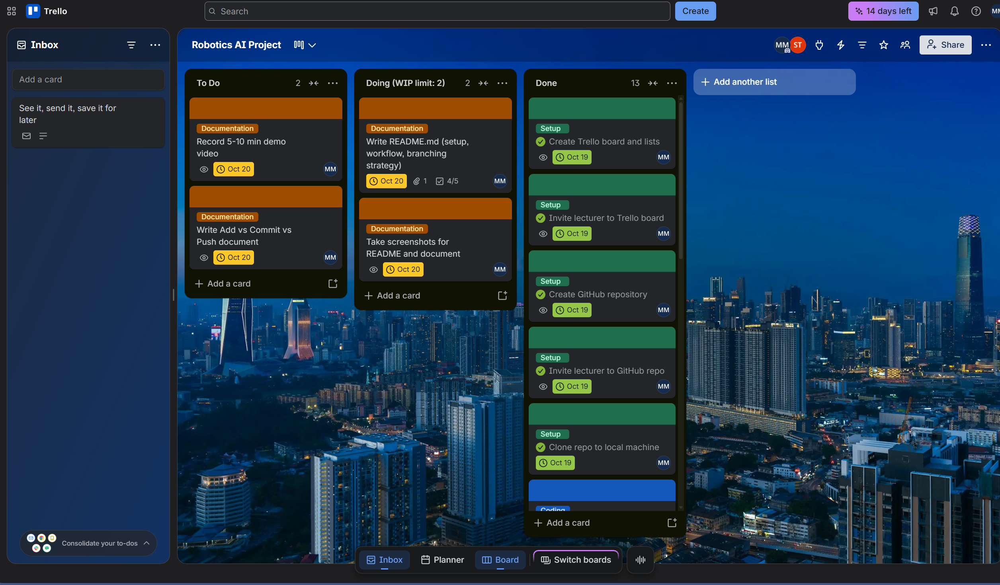
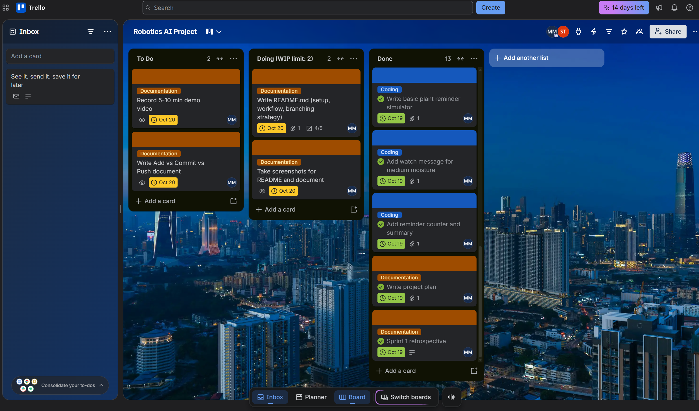
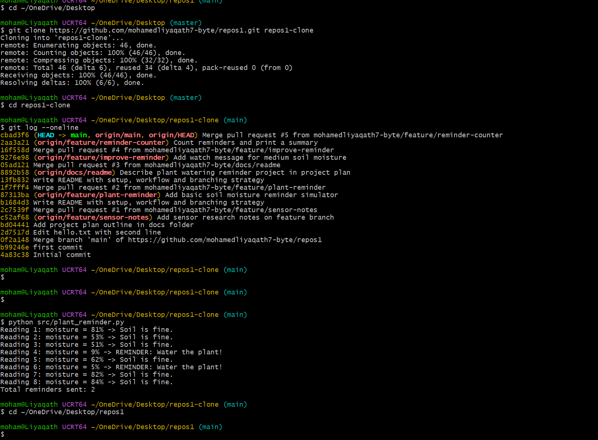
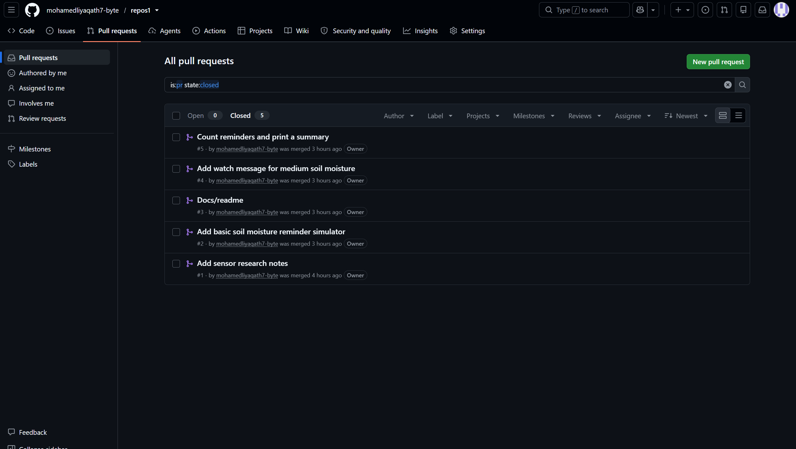
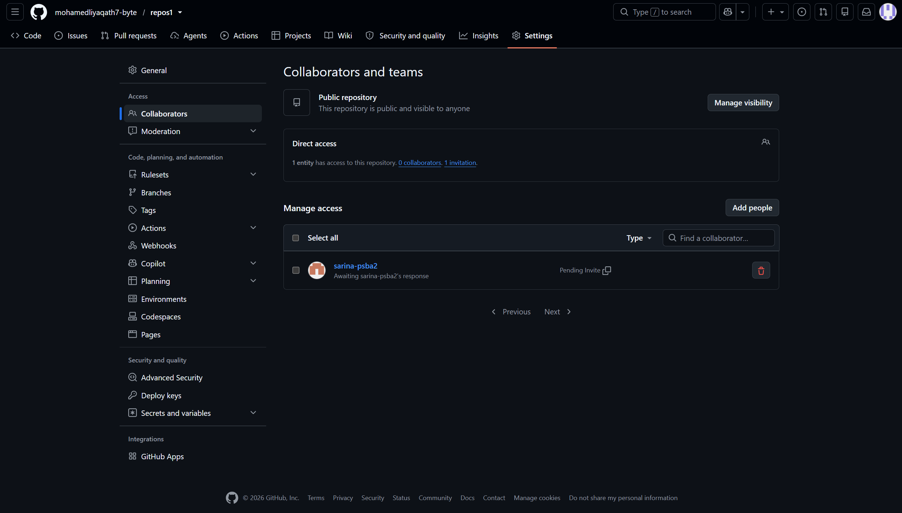
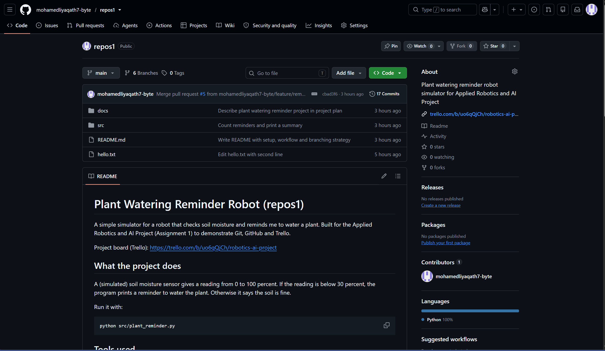

# Plant Watering Reminder Robot (repos1)

A simple simulator for a robot that checks soil moisture and reminds me to water a plant. Built for the Applied Robotics and AI Project (Assignment 1) to demonstrate Git, GitHub and Trello.

Project board (Trello): https://trello.com/b/uo6qQjCh/robotics-ai-project

## What the project does
A (simulated) soil moisture sensor gives a reading from 0 to 100 percent. If the reading is below 30 percent, the program prints a reminder to water the plant. Otherwise it says the soil is fine.

Run it with:
```
python src/plant_reminder.py
```

## Tools used
- **Git / Git Bash** for version control on my computer
- **GitHub** for the remote repository and pull requests
- **Trello** for planning (To Do, Doing, Done)
- **Visual Studio Code** for writing code

## Setup
1. Install Git for Windows from git-scm.com and open Git Bash.
2. Set my identity:
```
   git config --global user.name "mohamed liyaqath"
   git config --global user.email "mohamedliyaqath7@gmail.com"
```
3. Create the repository on GitHub, then connect it:
```
   git init
   git remote add origin https://github.com/mohamedliyaqath7-byte/repos1.git
   git branch -M main
```
4. GitHub already had a README, so I merged it before the first push:
```
   git pull origin main --allow-unrelated-histories --no-edit
   git push -u origin main
```
5. To work on another computer, clone the repo:
```
   git clone https://github.com/mohamedliyaqath7-byte/repos1.git
```

## Workflow
1. Plan the task as a card in Trello (To Do), and move it to Doing when I start.
2. Create a branch for the task.
3. Edit files, then Add, Commit and Push.
4. Open a Pull Request on GitHub and merge it into `main`.
5. Pull the latest `main` locally and move the card to Done.

## Add, Commit and Push
| Command | What it does |
|---|---|
| `git add` | Stages changes so they are included in the next commit |
| `git commit -m "message"` | Saves the staged changes as a snapshot in local history |
| `git push` | Uploads local commits to GitHub |

## Branching strategy
- `main` holds stable, reviewed work.
- New work is done on short-lived branches such as `feature/plant-reminder` or `docs/readme`.
- Each branch is merged into `main` through a Pull Request.

Example:
```
git checkout -b feature/plant-reminder
git add src/plant_reminder.py
git commit -m "Add basic soil moisture reminder simulator"
git push -u origin feature/plant-reminder
```

## Project structure
```
README.md
hello.txt
docs/
  project-plan.md
  sensor-notes.md
src/
  plant_reminder.py
```

## About this project

This is a simulator for a robot that reminds me to water a plant. It follows the basic robot pattern of sensor, decision and action.

1. **Sensor:** reads the soil moisture as a number from 0 to 100 percent (simulated with random numbers).
2. **Decision:** below 30 percent the soil is too dry, between 30 and 50 percent I should keep an eye on it, and above 50 percent it is fine.
3. **Action:** the program prints "REMINDER: Water the plant!" when the soil is dry and counts the reminders.

Run it with: `python src/plant_reminder.py`

## Screenshots

**Trello board.** Three lists, coloured labels, due dates and the lecturer as a member.



**Done cards with pull request links.** Each finished card links to its pull request.



**Commit history.** The full history and the project running from a clone.



**Pull requests.** Five merged pull requests.



**Collaborators.** The lecturer is invited as a collaborator.



**Repository.** The public repository main page.


